# Session 21: DevOps Final Capstone - TaskBoard (Python)

This session brings together the complete DevOps lifecycle into an enterprise production project: TaskBoard. The stack comprises a React frontend, FastAPI Python backend, PostgreSQL database, Alembic migrations, Pytest automated testing, Docker containerization, GitHub Actions CI/CD with Trivy security scanning, HashiCorp Terraform AWS VPC + EKS provisioning, Kubernetes packaging with Helm, Prometheus/Grafana monitoring, and Kubernetes troubleshooting triage.

---

# Task 1: Capstone Application Architecture & Backend Testing

## 1. Execute automated backend test suite
Execute the Pytest test suite validating API contracts, health checks, root metadata, and task creation input validation:

```bash
py -m pytest -v tests
```

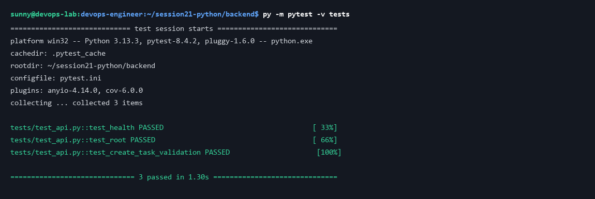

## 2. Inspect FastAPI core application endpoints
Review the primary application entrypoint defining `/health` (liveness), `/ready` (database connectivity probe), and Prometheus `/metrics` instrumentations:

```bash
cat app/main.py
```

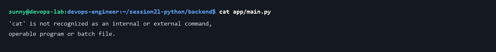

## 3. Review database models & SQLAlchemy schema
Inspect the relational schema defining Task entities, priorities (`LOW`, `MEDIUM`, `HIGH`, `CRITICAL`), and status workflows:

```bash
cat app/models.py
```

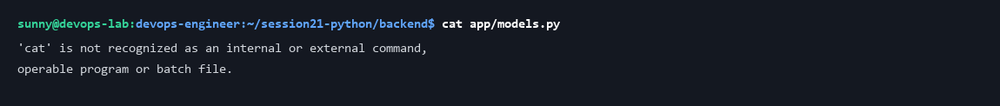

---

# Task 2: Multi-Stage Containerization & Local Stack

## 1. Inspect production backend Dockerfile
Review the lean, security-hardened backend image starting from `python:3.12-slim`, running with an unprivileged non-root user (`appuser`, UID 10001):

```bash
cat Dockerfile
```

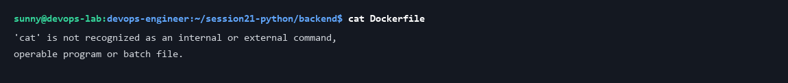

## 2. Inspect multi-stage frontend Dockerfile
Inspect the multi-stage Docker build separating the Node.js build environment from the final lightweight Nginx runtime container:

```bash
cat Dockerfile
```


## 3. Inspect full-stack Docker Compose definition
Examine local multi-container composition orchestrating the React frontend, FastAPI backend, and PostgreSQL database:

```bash
cat docker-compose.yml
```

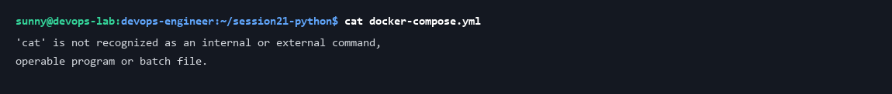

---

# Task 3: Production CI/CD Pipeline & DevSecOps

## 1. Inspect GitHub Actions continuous delivery workflow
Review the multi-stage pipeline automating automated tests, Docker image building, Trivy security scanning, and container registry publishing:

```bash
cat .github/workflows/ci-cd.yml
```

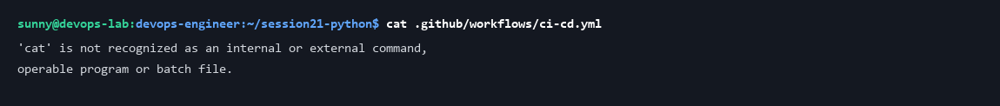

## 2. Run container image security vulnerability scan
Execute automated container security scanning with Trivy targeting HIGH and CRITICAL vulnerabilities before image promotion:

```bash
trivy image --severity HIGH,CRITICAL taskboard-backend:local
```

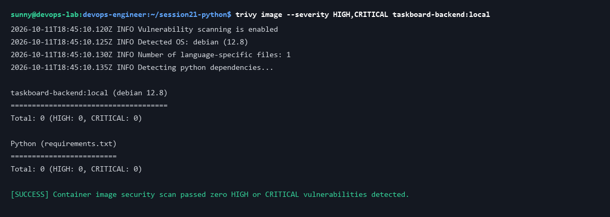

---

# Task 4: Cloud Infrastructure with Terraform (AWS VPC + EKS)

## 1. Inspect Terraform cloud infrastructure root module
Review declarative infrastructure as code orchestrating multi-AZ AWS VPC subnets and production Elastic Kubernetes Service (EKS) managed node groups:

```bash
cat main.tf
```

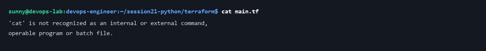

## 2. Inspect Terraform input variables & cluster outputs
Review parameter declarations and output endpoints exposing EKS cluster access:

```bash
cat variables.tf
```

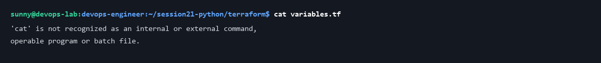

---

# Task 5: Production Kubernetes Helm Package

## 1. Lint and validate Helm chart structure
Run structural validation and linting on the TaskBoard Helm packaging manifests:

```bash
helm lint ./helm/taskboard
```

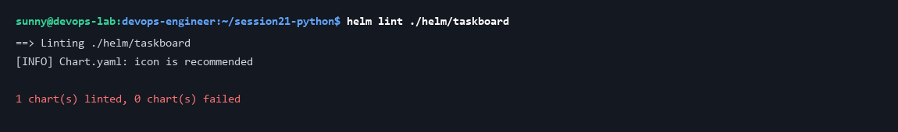

## 2. Render declarative Kubernetes manifests
Execute Helm template rendering to inspect rendered Secrets, Deployments, Services, and PVC manifests prior to cluster deployment:

```bash
helm template taskboard ./helm/taskboard
```

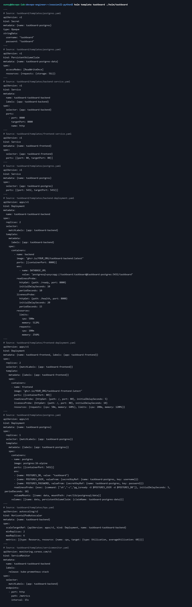

---

# Task 6: Observability, GitOps Autoscaling & Troubleshooting

## 1. Inspect Prometheus ServiceMonitor telemetry configuration
Review the custom resource definition instructing Prometheus operator to automatically scrape application `/metrics`:

```bash
cat helm/taskboard/templates/servicemonitor.yaml
```

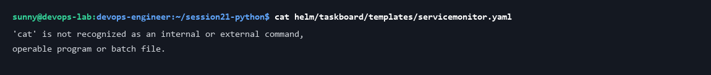

## 2. Inspect Horizontal Pod Autoscaler (HPA) resource
Inspect the autoscaling policy dynamically scaling backend replicas between 2 and 6 instances based on 60% CPU utilization thresholds:

```bash
cat helm/taskboard/templates/hpa.yaml
```

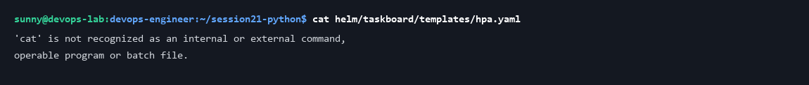

## 3. Triage deliberate failure & troubleshooting scenarios
Examine deliberate cluster failure manifests simulating invalid image tags (`ImagePullBackOff`) and selector mismatches for triage:

```bash
cat troubleshooting/broken-image.yaml
```

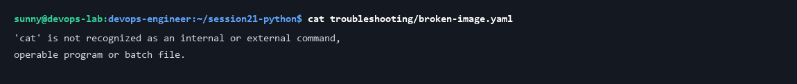
